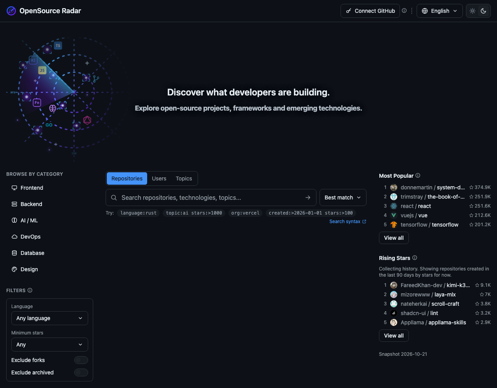

# OpenSource Radar

A small open-source tool for watching what is moving in open source: search GitHub repositories, browse by category, and see which projects are gaining stars, based on a daily snapshot rather than a single moment in time.

**Live:** https://shiei.github.io/gh-radar/



## What it does

- **Search** GitHub repositories, users or topics with the full GitHub query syntax (`language:rust stars:>500`, `topic:ai`, `org:vercel`), with sort, paging, and result cards that show activity, last push, open issues, size, license and more.
- **Filters** for language, minimum stars, forks and archived repositories, turned into query qualifiers for you. Languages and topics on a result card are clickable shortcuts.
- **Browse by category**: Frontend, Backend, AI / ML, DevOps, Database, Design. Each is a curated topic query, one click away.
- **Rankings** from the daily snapshot: _Most Popular_ by stars and _Rising Stars_ by stars gained in the last 30 days. Filtered by the selected category, no API quota spent.
- **Optional GitHub token** to raise the search limit from 10 to 30 requests a minute. It stays in your browser (memory only unless you choose to remember it) and is sent only to `api.github.com`.
- English, Japanese and Chinese UI, dark and light themes.

## Where the data comes from

Search results come straight from the GitHub REST API in your browser. Rankings come from `public/data/`, which a GitHub Actions job rebuilds every day at 00:00 UTC: the top 300 popular and rising repositories for each of the six categories plus a small watchlist, about 2,000 repositories in total. It is deliberately a sample, not all of GitHub; the ranking tooltips say so. Older snapshots are kept for 30 days, per-repository star series for a year by day and then by week. Details: [scripts/README.md](scripts/README.md).

## Run it locally

```bash
npm install
npm run dev
```

Everything else (tests, lint, deployment, how the snapshot works) is in the docs:

- [docs/development.md](docs/development.md): stack, project layout, scripts, conventions
- [docs/deploy.md](docs/deploy.md): GitHub Pages deployment and the daily workflow
- [scripts/README.md](scripts/README.md): the snapshot script and data files
- [ROADMAP.md](ROADMAP.md): what is done and what might come next

This is a personal project. Issues and pull requests are welcome, but there is no release schedule and no guarantee of a quick reply.

## License

[MIT](LICENSE)

---

**日本語**：GitHub のリポジトリ・ユーザー・トピックを検索し、カテゴリから探し、日次スナップショットに基づいて「どのプロジェクトが伸びているか」を眺めるための個人製ツールです。ランキングは GitHub 全体ではなく、6 カテゴリ × 上位 300 件ほどのサンプルを対象にしています。

**中文**：一个个人维护的开源小工具：检索 GitHub 仓库、用户和主题，按分类浏览，并基于每日快照观察哪些项目在涨。榜单的范围是六个分类各前 300 条左右的样本，不是全 GitHub。
