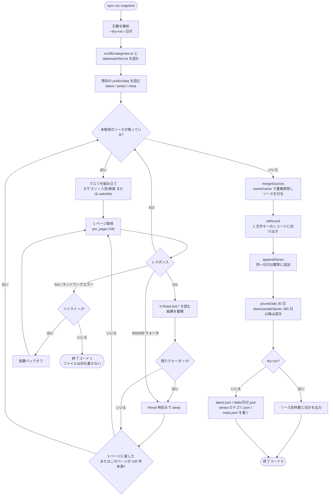

# Design

## Context

サイトは純粋な静的 Vite ビルドであり、`public/` 配下のファイルはそのまま成果物に入るため、`public/data/` は `npm run dev` でも読め、GitHub Pages でも一緒に公開される。`src/lib/github/` には既に `request()`、クォータ解析、`searchRepositories()` があるが、これらはブラウザ向け（グローバル `fetch`、localStorage のトークン）である。スクリプトは Node 24 で動作し、`fetch` が利用できる。振る舞いの契約は `specs/daily-snapshot/spec.md` を参照。

## Goals / Non-Goals

**Goals:**
- サーバーゼロ、データベースゼロ：データはリポジトリ内の JSON そのものである。
- スクリプトとサイトで分類マッピングを共有し、2 か所の定義がずれるのを防ぐ。
- すべてのデータ変換は純関数であり、jsdom の外で Vitest によりテストできる。

**Non-Goals:**
- GH Archive のイベントストリームは取得しない。コントリビューター統計も行わない。
- 本 change ではフロントエンドの表示を変更しない（データは `discovery-home` が消費する）。
- リポジトリのリネームや削除の履歴統合は扱わない。リネーム後は新しいリポジトリとみなす。

## Decisions

### D1. ディレクトリと依存
```
scripts/snapshot.ts          エントリ：引数解析、スケジューリング、ファイル書き込み
scripts/lib/fetchRepos.ts    クォータ待機とリトライ付きの search ページング取得（Node fetch）
scripts/lib/transform.ts     merge / toRecord / appendSeries / prune / downsample（純関数）
scripts/lib/io.ts            public/data の読み書き
src/lib/categories.ts        分類マッピング（サイトとスクリプトで共用、React に依存しない）
public/data/                 出力
data/watchlist.txt           手動のウォッチリスト。1 行に owner/name、# はコメント
.github/workflows/snapshot.yml
```
`tsx` でスクリプトを実行し、別途コンパイルはしない。スクリプトは最小の search クライアントを自前で実装し、`src/lib/github/request.ts` は再利用しない。後者はブラウザのトークン保存に結び付いているためである。両者が共有するのは定数（API バージョンヘッダー）のみ。

### D1b. スクリプトの流れ

スクリプトは TypeScript で、`tsx` により Node 24 上で直接実行する。全体は 3 段階に分かれる：取得（唯一副作用を持つネットワーク段階）、変換（純関数）、書き込み（dry-run でなく、かつすべて成功した場合のみ行う）。



Actions ワークフローはスクリプトの外側をさらに一層包む：

```mermaid
flowchart LR
  S([cron 00:00 UTC<br/>または手動実行]) --> C[checkout + setup-node + npm ci]
  C --> R[npm run snapshot]
  R -- 非ゼロ終了 --> F([ワークフロー失敗<br/>データファイルは前回のまま])
  R -- 成功 --> G{git status に変更がある?}
  G -- いいえ --> N([終了、commit なし])
  G -- はい --> P[commit 'data: snapshot 日付 (N repos)'<br/>master へ push]
```

### D2. 取得戦略
各ソースは `per_page=100` で 3 ページ取得する（新星クエリの star 下限は 20 に下げる。そうしないと 3 か月以内の新規プロジェクトで分類の下限を越えられるものがほとんどない）。レスポンスごとに `X-RateLimit-Remaining` を読み、0 なら `X-RateLimit-Reset` まで sleep する。リクエストは直列に行う。5xx とネットワークエラーは指数バックオフで 3 回リトライする。422（1000 件超過）はそのソースの終端とみなす。watchlist は `GET /repos/{owner}/{repo}` で 1 件ずつ取得し、コアプールを使う。1 回の実行で約 40 回の search と watchlist 件数分のコアリクエストになる。

### D3. ファイル形式
```jsonc
// latest.json
{ "date": "2026-10-21", "repos": { "vercel/next.js": { "s": 130000, "f": 28000, "i": 3100, "p": "2026-10-20T22:11:00Z", "c": "2016-10-05T...", "l": "JavaScript", "t": ["react","nextjs"], "a": false, "src": ["frontend:popular","watchlist"] } } }
// series/frontend.json
{ "vercel/next.js": [["2026-10-21", 130000], ...] }
// meta.json
{ "lastRun": "2026-10-21T00:04:12Z", "date": "2026-10-21", "total": 2140, "sources": { "frontend:popular": 300, ... } }
```
キー名を 1 文字にしているのはサイズ圧縮のためである。初回の実測（2026-10-20、2079 リポジトリ）では `latest.json` は 635 KB で、大半は topics 配列が占め、gzip 後は約 100 KB になり、Pages が圧縮して転送する。将来 1 MB を超えたら topics を先頭 10 件に切り詰めることを検討する。フロントエンドには 1 文字キーを名前付きの型に展開するデコード関数がある。系列に star だけを保存するのは、それが曲線を描く必要のある唯一の量だからである。他のフィールドは `latest.json` を見ればよい。

### D4. 保持とダウンサンプリング
`prune(dailyDir, today, 30)` は 30 日を超えた日次ファイルを削除する。`downsample(series, today)`：365 日以内は日次で保持し、それより古いものは ISO 週でグループ化して各グループの最後の点だけを残す。系列に追加する前に同じ日付の点を削除し、冪等性を保証する。

### D5. Actions ワークフロー
`schedule: '0 0 * * *'` と `workflow_dispatch`。ステップ：checkout、setup-node 24、`npm ci`、`npm run snapshot`、`git status` に変化があれば `github-actions[bot]` としてコミットして push する。メッセージは `data: snapshot 2026-10-21 (2140 repos)`。`secrets.GITHUB_TOKEN` を使用し、`permissions: contents: write` が必要である。スクリプトのいかなる失敗も step を非ゼロで終了させ、コミットステップには進まない。

### D6. テスト
`scripts/lib/transform.test.ts` でマージの重複排除とソース付与、レコードの形、系列追加の冪等性、30 日クリーンアップ、365 日ダウンサンプリングの境界をカバーする。`fetchRepos` は注入した `fetch` でクォータ待機（擬似時計）と 422 による終了をテストする。スクリプトのエントリはテストせず、`--dry-run` で 1 回手動検証する。

## Risks / Trade-offs

- [GitHub は Actions の定期タスクを数十分遅延させたりスキップしたりすることがある] → 系列は日付で重複排除するため、遅れて到着しても影響しない。ある日が抜けた場合は曲線上の点が 1 つ欠けるだけで、フロントエンドは実際の日付で描画する。
- [毎日 1 つの commit が主ブランチの履歴を雑然とさせる] → まずは受け入れる。煩わしくなったらデータを `data` ブランチに移す。フロントエンドが読む URL は変わらない。
- [分類クエリの変更が系列の断絶を招く] → マッピングファイルの変更時に `meta.json` へバージョン番号を記録し、フロントエンドはバージョンが一致しない系列に注記を付ける。
- [Actions の GITHUB_TOKEN は他のワークフローをトリガーできない] → データ commit がデプロイのループを引き起こさないのでちょうどよい。デプロイワークフロー側は `paths: public/data/**` によるトリガーを別途許可する必要がある。
