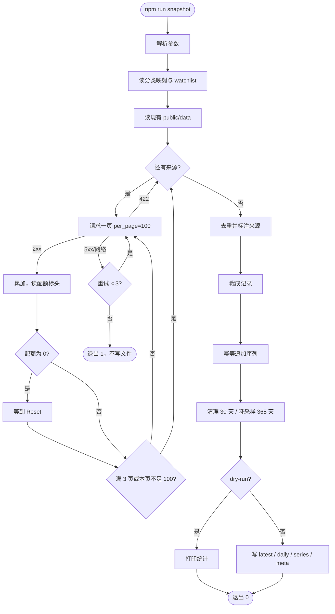

# scripts/

## snapshot.ts — 每日快照

对六个分类（`src/lib/categories.ts`）各取"热门"与"新秀"两条查询的前 300 条，加上 `data/watchlist.txt` 里的仓库，把 star、fork、未关闭 issue、最近推送、创建时间、语言、topics、归档标记写进 `public/data/`。GitHub Actions（`.github/workflows/snapshot.yml`）每天 UTC 00:00 跑一次并提交结果；本地随时可以手动跑。

```bash
GITHUB_TOKEN=ghp_xxx npm run snapshot            # 写入 public/data
npm run snapshot -- --dry-run                    # 只抓取并打印统计，不写文件
npm run snapshot -- --pages 1                    # 每个来源只取 1 页（调试用）
npm run snapshot -- --date 2026-10-21            # 指定快照日期（默认今天，UTC）
```

没有 `GITHUB_TOKEN` 也能跑，但 search 每分钟只有 10 次，脚本会在配额用尽时自动等到恢复，整轮约四分钟。

### 输出文件

| 文件                 | 内容                                                      | 保留                                  |
| -------------------- | --------------------------------------------------------- | ------------------------------------- |
| `latest.json`        | 当天全部仓库，`{ date, repos: { "owner/name": record } }` | 只留最新                              |
| `daily/<日期>.json`  | 与 `latest.json` 相同的当日原始快照                       | 30 天，超期自动删除                   |
| `series/<分类>.json` | 每个仓库的 `[["日期", star], ...]`，另有 `watchlist.json` | 365 天按天，更早按 ISO 周保留最后一点 |
| `meta.json`          | 最近一次成功时间、日期、总数、各来源数量、映射版本        | 只留最新                              |

记录用单字母键以控制体积：`s` star、`f` fork、`i` 未关闭 issue（含 PR）、`p` 最近推送、`c` 创建时间、`l` 主语言、`t` topics、`a` 是否归档、`src` 来源列表（如 `frontend:popular`、`devops:rising`、`watchlist`）。

### 流程



### 加入关注仓库

在 `data/watchlist.txt` 里每行写一个 `owner/name`，`#` 开头为注释。下次运行时会用 `GET /repos/{owner}/{name}`（核心配额）抓取并以 `watchlist` 来源记录。

### 代码结构

- `lib/fetchRepos.ts`：串行 GitHub 客户端，配额等待、指数退避重试、422 视为到达 1000 条上限。
- `lib/transform.ts`：纯函数，合并去重、记录裁剪、序列追加、清理、降采样。全部有单元测试。
- `lib/io.ts`：读写 `public/data` 与 watchlist。
- `snapshot.ts`：入口。
